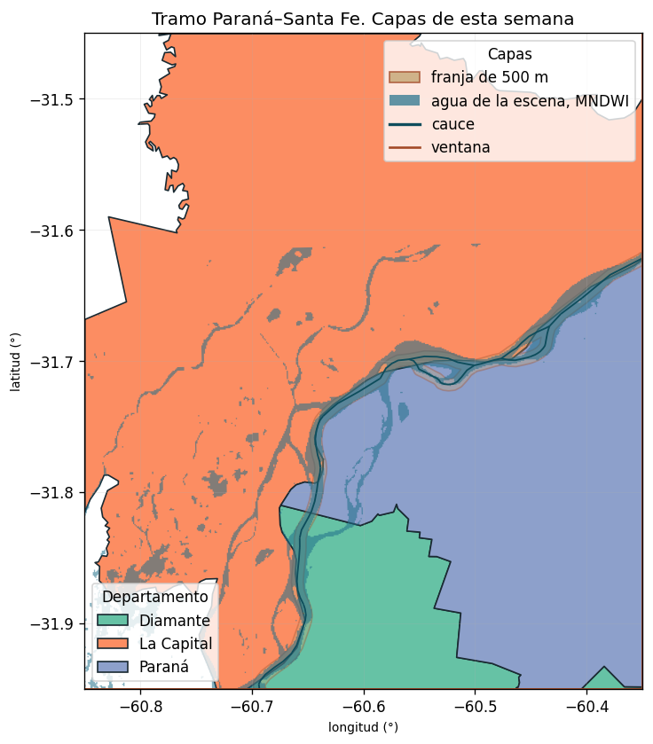

# Integración Espacial y Análisis de Inundabilidad: Tramo Paraná–Santa Fe

Este repositorio contiene la resolución del **Entregable 03** correspondiente al módulo de **Minería de Datos Espaciales** de la Maestría en Minería de Datos.

El proyecto integra fuentes de datos vectoriales (límites administrativos, hidrografía y zonas de amortiguación) con teledetección óptica (clasificación espectral de agua superficial vía Sentinel-2) para analizar la estructura espacial y el impacto de crecidas en la ventana de estudio `[-60.85, -31.95, -60.35, -31.45]`.

---

## 📁 Estructura del Repositorio

- **`03-entregable.ipynb`**: Notebook principal con la ejecución secuencial completa y validación del pipeline espacial.
- **`paquete_tramo.gpkg`**: GeoPackage que consolida las 4 capas de trabajo (`limite_tramo`, `cauce`, `franja_500m`, `agua_mndwi`).
- **`mapa_ejercicio.png`**: Mapa estático generado con Matplotlib integrando la totalidad de capas y la corrección de aspecto geográfica.
- **`visor_ejercicio.html`**: Visor cartográfico interactivo desarrollado con Folium/Leaflet con control de capas y panel de discusión.
- **`respuesta_ejercicio.txt`**: Documento de texto plano con la síntesis conceptual y conclusiones analíticas.

---

## 🗺️ Mapa Integrado



---

## 📝 Discusión Teórica y Síntesis Metodológica

> **Con las variables analizadas, las áreas se agrupan en tres unidades espaciales:**
> 1. **Sistema fluvial activo e islas de inundación:** Intersección del cauce principal del río Paraná y las masas de agua detectadas mediante el índice espectral MNDWI.
> 2. **Ribera de interfase inmediata:** Franja de amortiguación métrica de 500 m adyacente al cauce que contacta con los departamentos La Capital, Paraná y Diamante.
> 3. **Terraza alta continental:** Territorio interior departamental situado fuera del buffer de 500 m y sin presencia de agua libre en la fecha analizada.
>
> **Límite analítico:** Ante la ausencia de un Modelo Digital de Elevación (DEM), solo se lee la condición hídrica instantánea capturada por el sensor en la fecha de la escena. Sin cotas altimétricas ni pendientes de terreno, no es posible modelar el avance escalonado ante crecidas de +2 m, +4 m o +6 m.

**Conclusión:**  
*«Con el cauce, la franja de 500 m y el agua de esta escena, estos lugares son del mismo tipo porque comparten proximidad de ribera y cobertura hídrica instantánea. El río que sube en +2 m, +4 m y +6 m todavía no se lee: falta el terreno.»*

---

## 🚀 Requisitos de Ejecución Local

Para reproducir el notebook localmente:

```bash
pip install geopandas shapely pyproj matplotlib folium rasterio
jupyter notebook 03-entregable.ipynb
